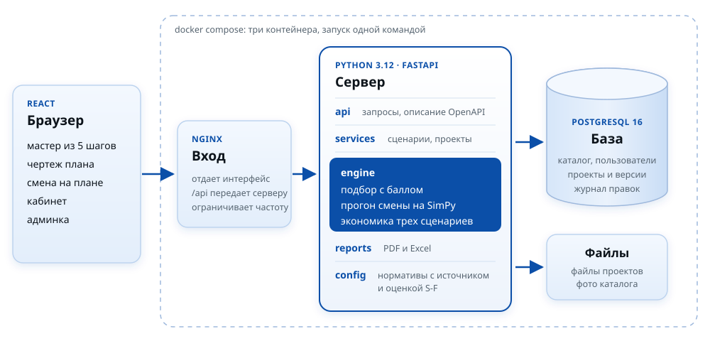

# Расклад

Веб-сервис, который подбирает роботизированные решения под объект, проверяет их прогоном смены на плане и считает, окупится ли внедрение. Команда unicorn, хакатон "Лидеры цифровой трансформации 2026", задача №1.

[Стенд](https://rasklad-robots.ru) · [Запустить у себя](#быстрый-запуск) · [Как устроено](#архитектура) · [Документация](docs/documentation.md) · [Изменения с 30.09](CHANGELOG.md)

## Что умеет

- Склад, полный путь. Описать объект и задачи (перевозка паллет, штучный отбор, уборка), получить план склада (типовой, по ответам, по фото или по чертежу DXF), выбрать решения из каталога с объяснением, прогнать смену на плане и получить экономику.
- Медучреждение, тоже полный путь. План корпуса по этажам, подбор под задачи больницы, смена на плане с лифтами и очередями, экономика и отчет.
- Аэропорт: параметры объекта и список подходящих решений с объяснением, без плана и экономики.
- Экономика: парк, вложения, окупаемость, ROI, NPV, IRR и стоимость владения за 5 лет в трех сценариях (без роботов, покупка, аренда), с кредитом, лизингом и господдержкой, "что будет, если" и вывод интервалом с рисками.
- Готовые разборы реальных внедрений на странице `/cases`, каталог роботов для гостя на `/catalog`, методика расчета на `/method`.
- Проекты с версиями и сравнением, отчет PDF и таблицы Excel.
- Администратору: каталог и нормативы, загрузка и выгрузка каталога файлом, проверка обновлений характеристик на сайтах производителей.

Демо-расчет склада, перевозка паллет Ronavi H1500 на примере из `docs/example/request.json`: 9 роботов, вложения 33,0 млн ₽ без НДС, окупаемость покупки 1,1 года. Как повторить руками: [раздел 6.10 документации](docs/documentation.md#610-воспроизведение-демо-расчета).

## Что изменилось с 30.09

- Медучреждение теперь с полным путем: план корпуса, смена на плане, экономика, отчет.
- Готовые разборы реальных внедрений на `/cases`, цифры на всех шагах сходятся и приходят с сервера.
- Экономика с выбором оплаты (свои деньги, кредит, лизинг, аренда) и сроком службы робота отдельно от амортизации.
- Чертеж из AutoCAD (DXF) сразу становится планом склада: здание, ряды стеллажей, ворота и буфер из слоев и блоков чертежа.
- Смена на плане со смешанным парком.
- Шаги мастера стали понятнее: меньше текста, один главный ответ сверху.
- Шаг 5 отвечает на нажатие за секунды.

Полный список: [CHANGELOG.md](CHANGELOG.md).

## Быстрый запуск

Нужен Docker с Compose. Интернет для работы не нужен: данные лежат в репозитории и попадают в базу при первом запуске.

```bash
cp .env.example .env
docker compose up --build
```

| Адрес | Что там |
|---|---|
| http://localhost:3000 | Лендинг |
| http://localhost:3000/calc | Расчет без входа |
| http://localhost:3000/login | Вход и регистрация |
| http://localhost:3000/cases | Готовые разборы |
| http://localhost:3000/catalog | Каталог роботов |
| http://localhost:3000/method | Как мы считаем |
| http://localhost:8000/api/docs | Описание API (OpenAPI) |
| http://localhost:8000/api/db | Служебные таблицы администратора |

Тестовые входы. При запуске создаются два аккаунта: пользователь и администратор. Почты и пароли для запуска у себя лежат в `.env.example` (строки `DEMO_USER_*` и `DEMO_ADMIN_*`), входят в них на обычном экране входа. Для регистрации подойдет любая почта вида `ivan@example.com`: без настроенной почты письма не уходят, код при регистрации не нужен, ссылка на новый пароль ложится в служебную таблицу администратора.

Стенд: https://rasklad-robots.ru. Демо-аккаунты стенда в материалах сдачи.

Если порты 3000 или 8000 заняты, задайте другие в `.env`: `FRONTEND_PORT`, `BACKEND_PORT`. Вернуть демо-проекты и каталог в исходный вид: `docker compose exec backend python -m scripts.reset_demo`. Если Docker Desktop не запускается: [запуск через WSL](docs/troubleshooting.md). Стенд с https: [docs/stand.md](docs/stand.md).

## Как пользоваться

Расчет идет мастером из пяти шагов, кнопка "Посчитать свой склад" на лендинге или адрес `/calc`. Входить не нужно.

1. Объект и задачи: склад, аэропорт или медучреждение, работа, которую заберут роботы.
2. Параметры: значения по умолчанию уже стоят, можно загрузить свой Excel или CSV.
3. План: типовая планировка, ответы на вопросы, фото или чертеж DXF, правка на чертеже.
4. Решение: робот на каждую задачу из подходящих, с причинами, при желании бюджет.
5. Экономика: ответ словами, смена на плане, три сценария, "что будет, если", отчет PDF и Excel, сохранение в проект.

После входа: главная `/home` с последним проектом и кабинет `/projects` с версиями, копиями и сравнением. Администратор: главная `/admin/home`, каталог и нормативы `/admin`. Подробно по экранам: [раздел 6.7 документации](docs/documentation.md#67-руководство-пользователя-и-администратора).

## Архитектура



- Интерфейс: React 19, TypeScript, Vite, свой набор компонентов в `frontend/src/ui`. Чертеж плана на SVG, проигрыватель смены на Canvas. Типы запросов генерируются из OpenAPI сервера.
- nginx в контейнере фронтенда отдает интерфейс и передает `/api` серверу, ограничивает частоту входа и тяжелых запросов, ставит заголовки безопасности.
- Сервер: Python 3.12, FastAPI. `app/api` принимает запросы, `app/services` собирает сценарии, `app/reports` делает PDF и Excel.
- Расчет: `app/engine`, чистые функции без базы и веба. Подбор, план и маршруты, экономика по сценариям, что подготовить на складе. Все формулы только на сервере, поэтому цифры на экране, в PDF и Excel одни и те же.
- Прогон смены: `app/engine/simulation.py` на SimPy. Выдает лог для проигрывателя и кривую "сколько роботов, столько операций в час", по ней экономика подбирает парк.
- Данные: PostgreSQL 16 через SQLAlchemy 2 и миграции Alembic. В базе каталог, пользователи, проекты с версиями, правки нормативов. Нормативы и коэффициенты с источниками лежат в `config/*.yaml`, в коде содержательных чисел нет.
- Стенд: та же сборка плюс Caddy с https и паролем на весь сайт (`docker-compose.stand.yml`).

Подробно, с таблицами компонентов, структурой данных и API: [раздел 6.3 документации](docs/documentation.md#63-архитектура-компоненты-структура-данных-api).

## Структура репозитория

```
backend/              сервер FastAPI
  app/api/            прием запросов, без логики
  app/services/       сценарии: подбор, расчет, каталог, проекты, нормативы
  app/engine/         расчет: подбор, план, прогон смены, экономика
  app/reports/        отчет PDF и таблицы Excel
  app/storage/        таблицы базы
  app/auth/           вход, роли, демо-аккаунты
  migrations/         миграции Alembic
  scripts/            подготовка базы, возврат демо-данных, замеры
  tests/              тесты pytest, в том числе API и эталонные расчеты
frontend/             интерфейс React
  src/app/            мастер: шаги, чертеж плана, смена на плане
  src/features/       лендинг, вход, главные, кабинет, админка, методика, разборы
  src/ui/             набор компонентов и токены оформления
  src/api/            типы из OpenAPI и запросы
  tests/              тесты логики интерфейса
  nginx.conf          раздача интерфейса и прокси к серверу
config/               нормативы, профили объектов, поля формы, шаблоны планов с источниками
data/                 каталог решений, характеристики со ссылками, параметры аэропорта и больницы
docs/                 документация, методика, журнал решений, примеры отчетов
stand/                настройка Caddy для стенда
docker-compose.yml    запуск у себя одной командой
.github/workflows/    проверки на каждый pull request
```

Каталог при первом запуске: 31 наше решение с характеристиками и источниками. Файлов организатора (выгрузки каталога, фото решений) в репозитории нет: по условию их нельзя публиковать. Если положить выгрузку в `data/organizer/catalog_export_v4.csv`, она загружается следом, и в каталоге 190 позиций. Иначе выгрузку загружает администратор в админке, правила загрузки в [разделе 6.6 документации](docs/documentation.md#66-порядок-загрузки-и-обновления-данных).

## Документация, тесты, API

- Сопроводительная документация, разделы 6.1-6.10: [PDF](docs/documentation.pdf), [исходник](docs/documentation.md).
- Методика расчета, все формулы с примерами руками: [docs/calculation.md](docs/calculation.md).
- Что решили и почему: [docs/decisions.md](docs/decisions.md). Границы и риски: [docs/mvp.md](docs/mvp.md).
- Источники данных и оценка доверия S-F: [docs/data-sources.md](docs/data-sources.md), значения характеристик со ссылками: [data/specs/](data/specs/).
- Как устроен код и как мы его пишем: [docs/architecture.md](docs/architecture.md). Безопасность: [docs/security.md](docs/security.md).
- Пример отчета по демо-расчету: [PDF](docs/example/report.pdf), [Excel](docs/example/report.xlsx), [запрос](docs/example/request.json).
- Что менялось после первой сдачи: [CHANGELOG.md](CHANGELOG.md).
- API: http://localhost:8000/api/docs после запуска.
- Проверки: на каждый pull request GitHub Actions запускает ruff и pytest сервера, lint, тесты, формат и сборку интерфейса, сборку образов Docker ([ci.yml](.github/workflows/ci.yml)). Тесты сервера идут на базе в памяти, Postgres для них не нужен.

## Требования ТЗ и где они сделаны

| Требование | Где сделано |
|---|---|
| Три типа объектов, параметры с единицами, источниками и границами | Шаги 1-2 мастера, [6.7](docs/documentation.md#67-руководство-пользователя-и-администратора) |
| Загрузка параметров из Excel и CSV с проверкой | Шаг 2, [6.6](docs/documentation.md#66-порядок-загрузки-и-обновления-данных) |
| Каталог с иерархией, источниками, датой и оценкой у каждой характеристики | Админка `/admin`, [6.6](docs/documentation.md#66-порядок-загрузки-и-обновления-данных) |
| Подбор с объяснением, исключением и пометкой "требует проверки" | Шаг 4, [6.4](docs/documentation.md#64-алгоритм-подбора-и-ранжирования-решений) |
| Парк, CAPEX, OPEX, эффект, окупаемость, ROI, TCO, амортизация | Шаг 5, [6.5](docs/documentation.md#65-экономическая-модель) |
| Три сценария: без роботов, покупка, роботы как услуга | Шаг 5, [6.5](docs/documentation.md#65-экономическая-модель) |
| Чувствительность и вывод интервалом с рисками | Шаг 5, "Что будет, если" |
| 2D-схема с маршрутами, роботами, зарядкой, KPI и узким местом | Шаг 5, "Смена на плане", для склада и медучреждения |
| Роли, проекты с версиями, сравнение, повтор расчета по версии данных | Кабинет, [6.3](docs/documentation.md#63-архитектура-компоненты-структура-данных-api) |
| Отчет PDF и таблицы Excel | Шаг 5, [пример](docs/example/) |
| Запуск одной командой, СУБД, OpenAPI, 1366 на 768 | [6.2](docs/documentation.md#62-инструкция-по-развертыванию-и-запуску), `/api/docs` |
| Кредит, лизинг, господдержка, выход на режим | Шаг 5, "Условия и господдержка", [calculation.md](docs/calculation.md) |
| Автообновление каталога | Админка, "Проверить обновления", [6.6](docs/documentation.md#66-порядок-загрузки-и-обновления-данных) |

По каждому пункту со статусом, путем на экране и ссылкой на код: [docs/scope.md](docs/scope.md).

Пять тем, которые организатор попросил проработать самостоятельно (исключение неподходящих решений, состав CAPEX и OPEX, допущения по неполным данным, роботы как услуга, расширение каталога), разобраны в разделе [Что мы прорабатывали сами](docs/documentation.md#что-мы-прорабатывали-сами).

## Ограничения

- У аэропорта нет плана, прогона смены и экономики.
- В подборе нет правил ровности пола, температуры и WMS: этих полей нет в каталоге.
- Живой интеграции с WMS и 1С нет, вместо нее импорт выгрузок и API.
- Цифры по медучреждению и аэропорту опираются на открытые источники и допущения, а не на замеры с реального объекта: у складов мы сверяли расчет с опубликованными внедрениями, у медучреждения только начали.

Остальное и план развития: [раздел 6.9 документации](docs/documentation.md#69-известные-ограничения-и-план-развития).

## Разработка без Docker

Нужны Python 3.12 и Node.js 24.

```bash
cd backend
pip install -e ".[dev]"
pytest
uvicorn app.main:app --reload
```

```bash
cd frontend
npm install
npm run dev
```
